# WanderWise AI — AI Travel Planner

A responsive React + Bootstrap travel planner with a Node.js/Express API, Google Gemini integration, and MongoDB trip history.

## Features
- Responsive Bootstrap UI with trip preferences form
- AI-generated day-by-day itinerary using Gemini
- Server-side API key handling (never expose your key in React)
- Input validation, loading state, API error handling
- An AI-generated, optional follow-up tailored to each trip's details
- Optional MongoDB persistence and saved-trip history
- Dedicated itinerary, saved trips, and how-it-works pages with browser back/forward navigation
- Copy itinerary and start a new trip
- Demo mode when no Gemini key is configured, so you can preview the UI

## Requirements
- Node.js 20.19+ or 22.12+
- npm
- MongoDB local or MongoDB Atlas (optional for generation; needed for saving trip history)
- Gemini API key from Google AI Studio

## Project structure
```text
WanderWise-AI-Travel-Planner/
├── client/                 # React + Vite + Bootstrap
│   ├── src/
│   ├── .env.example
│   └── package.json
├── server/                 # Express API + Gemini + MongoDB
│   ├── models/
│   ├── routes/
│   ├── .env.example
│   └── package.json
└── README.md
```

## 1. Run the frontend
Open a terminal in `client`:
```bash
npm install
npm run dev
```
Vite runs at http://localhost:5173.

## 2. Run the backend
Open another terminal in `server`:
```bash
npm install
```
Copy `.env.example` to `.env` and configure it:
```env
PORT=5000
CLIENT_ORIGIN=http://localhost:5173
GEMINI_API_KEY=your_gemini_api_key_here
GEMINI_MODEL=gemini-3.5-flash-lite
MONGODB_URI=mongodb://127.0.0.1:27017/wanderwise
```
Then run:
```bash
npm run dev
```
Backend runs at http://localhost:5000.

Get a Gemini API key from https://aistudio.google.com/app/apikey. The key belongs only in `server/.env`. Never put it in `client/.env` or commit it to GitHub.

If you don't have MongoDB installed, use MongoDB Atlas and replace `MONGODB_URI` with your connection string. The app can generate plans without MongoDB; save/history endpoints will report that the database is not connected.

## 3. Try it
Fill out the trip form, answer the optional follow-up, and select **Create my itinerary**. The planner takes you to a dedicated itinerary page where you can review, copy, and save the plan. Open **Saved trips** in the navigation to revisit or delete saved itineraries. The **How it works** page explains the planning flow and AI limitations. Without a Gemini key, the backend returns a neutral follow-up question and a clearly labeled sample itinerary so you can test the frontend. Add the key to enable AI-generated questions and itineraries.

The client uses lightweight hash-based pages: `#home`, `#itinerary`, `#saved-trips`, and `#how-it-works`. Browser back and forward navigation are supported.

## API routes
- `GET /api/health` — backend and database status
- `POST /api/itinerary/follow-up` — validate trip details and generate one tailored question
- `POST /api/itinerary/generate` — validate input and generate itinerary
- `GET /api/trips` — list saved trips (requires MongoDB)
- `POST /api/trips` — save a trip (requires MongoDB)
- `DELETE /api/trips/:id` — delete a saved trip (requires MongoDB)

## Notes
- AI itineraries are suggestions, not verified live information. Verify opening hours, transport, visa requirements, prices, and safety advice before travelling.
- Do not commit `.env` files or real credentials.
- See [AI-TOOLS.md](./AI-TOOLS.md) for a short note on AI-assisted development and review.

## Screenshots

### Landing and how it works
| Home | How it works |
|---|---|
| 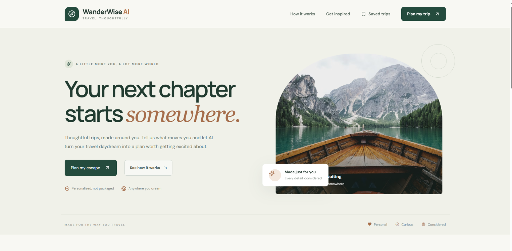 | 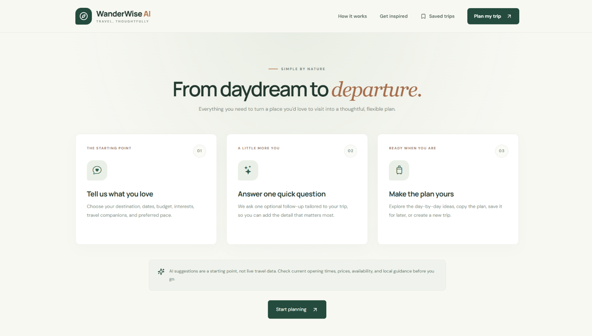 |

### Trip planning form
| Destination and occasion | Interests | Pace and notes |
|---|---|---|
| 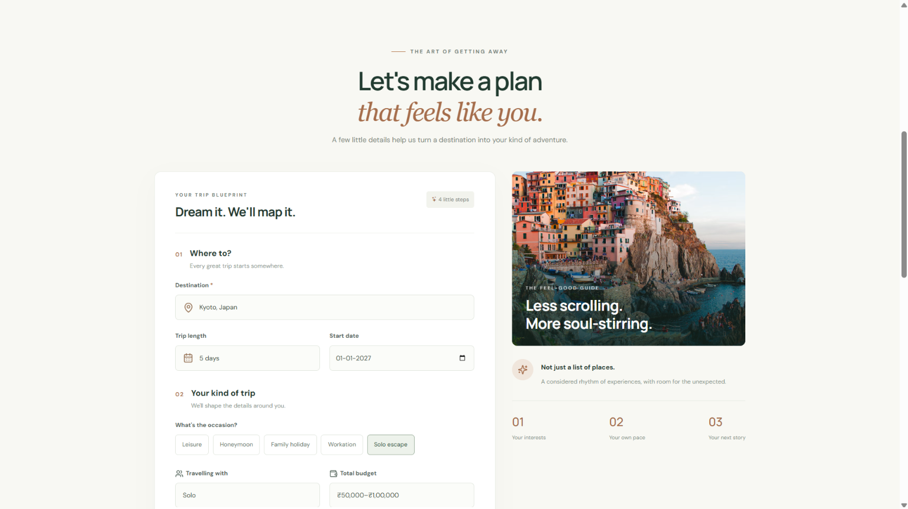 | 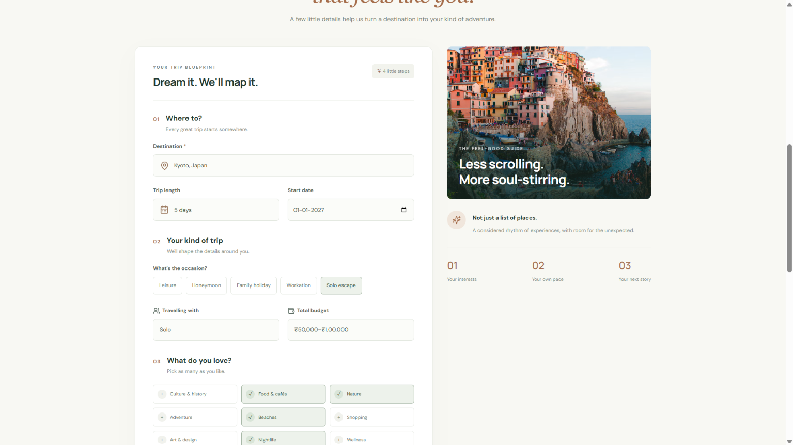 | 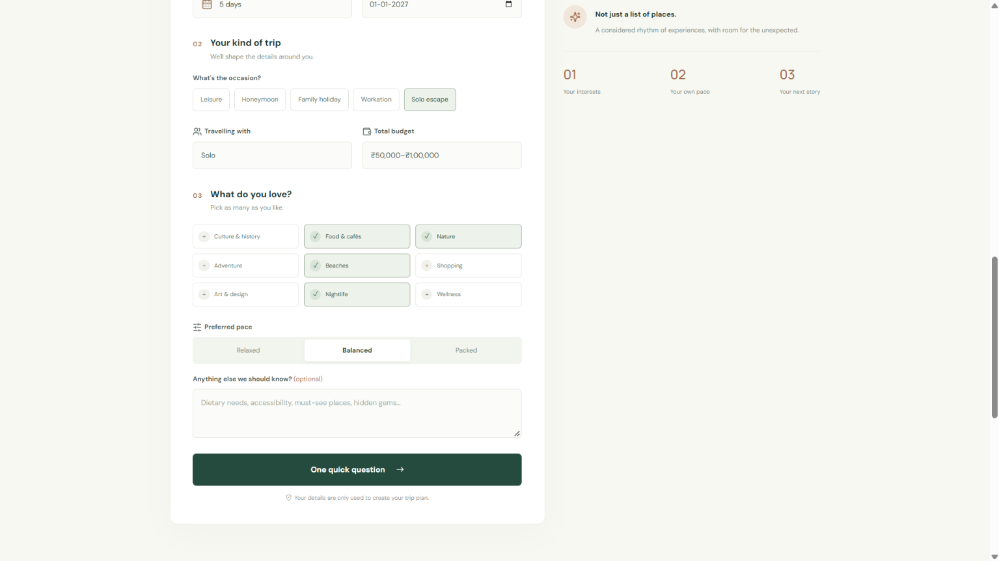 |

### AI flow
| Follow-up question | Loading state | Error handling |
|---|---|---|
| 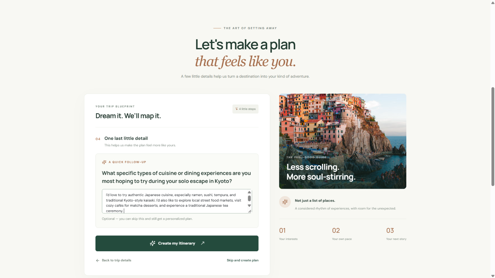 | 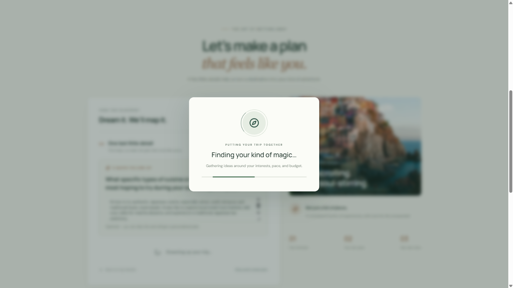 | 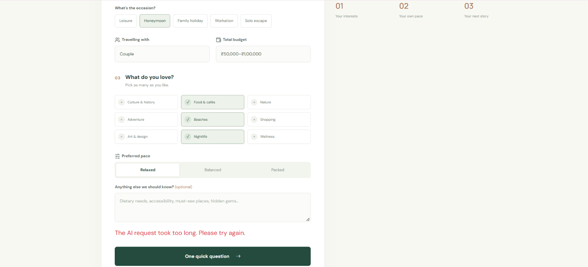 |

### Generated itinerary
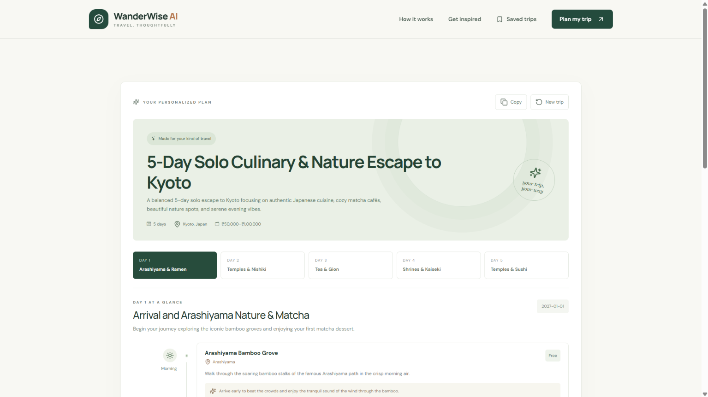

| Day 1 | Day 2 |
|---|---|
| 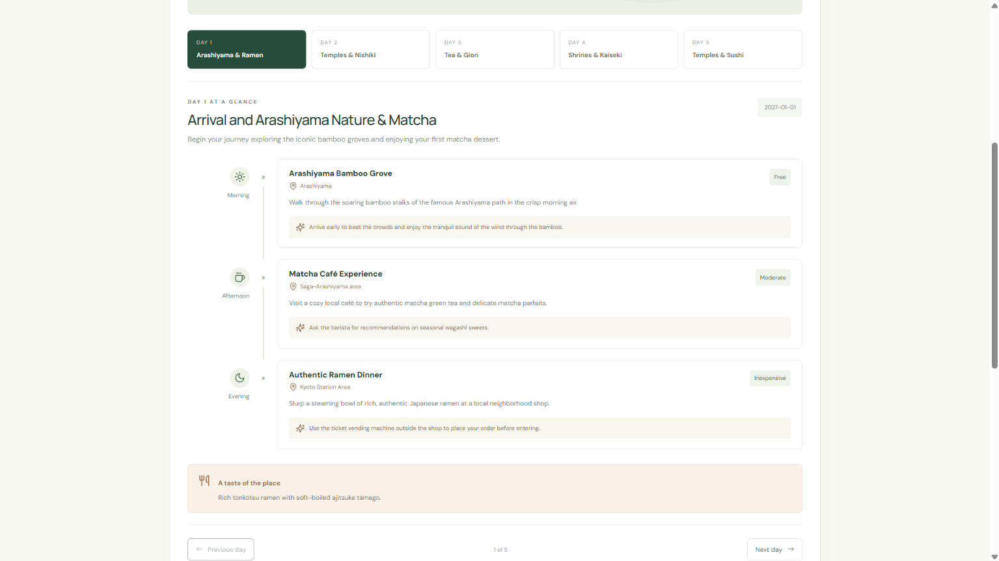 | 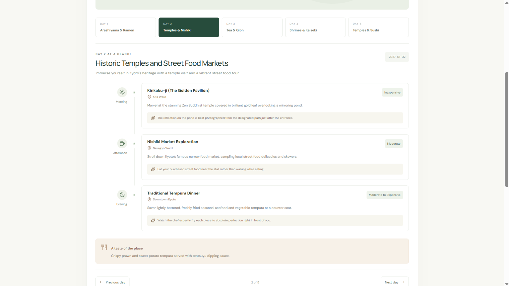 |

| Day 3 | Day 4 | Day 5 |
|---|---|---|
| 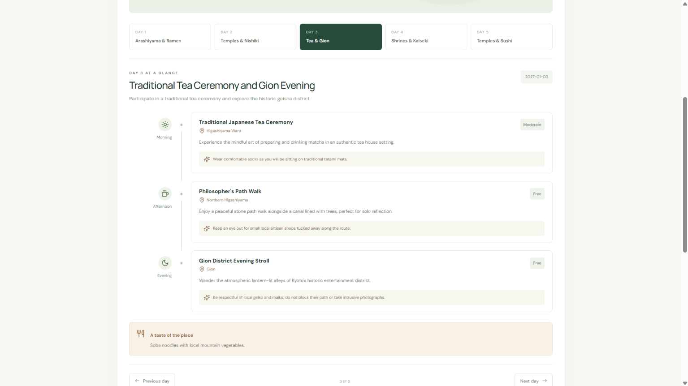 | 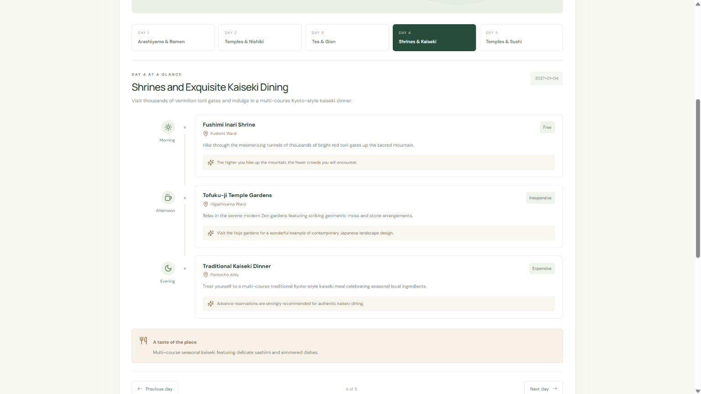 | 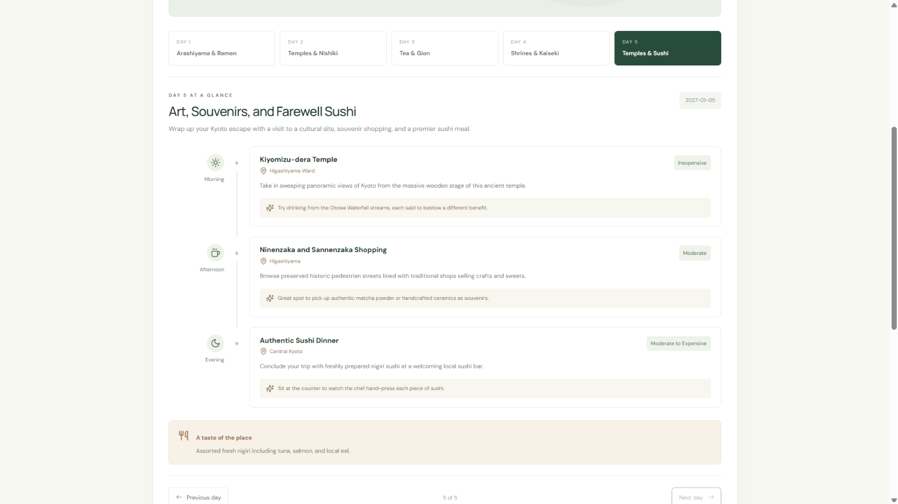 |

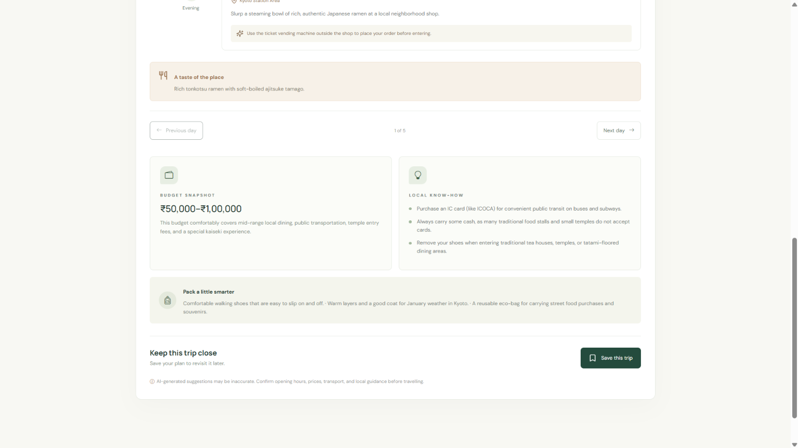

### Saved trips
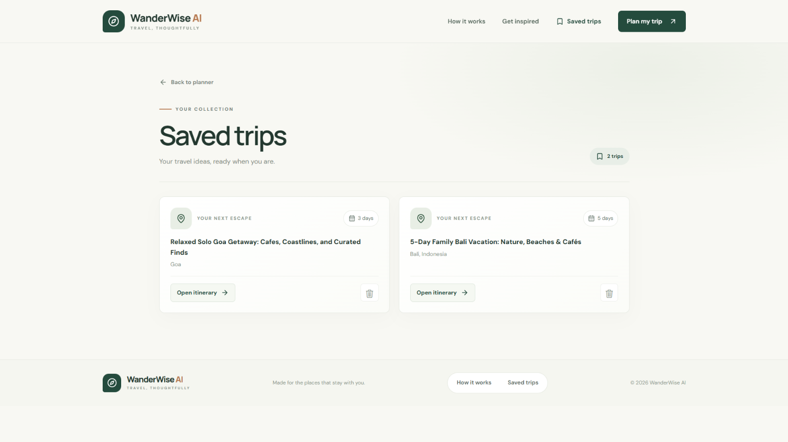